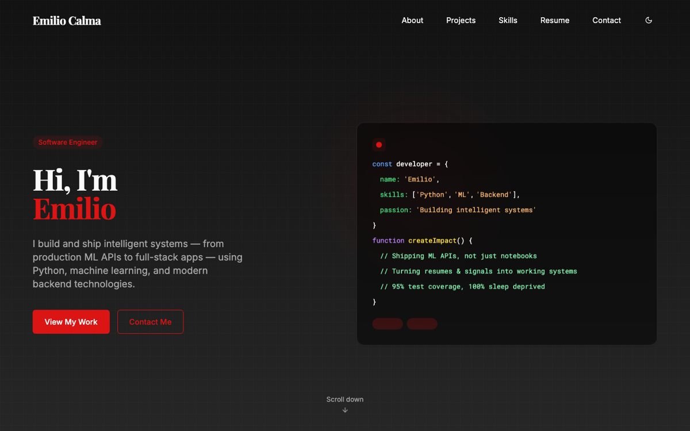

# Emilio Calma — Portfolio

Personal portfolio of Emilio Joseph Calma — software engineer focused on machine learning, AI, and backend development.

**Live:** [h4iseportfolio.netlify.app](https://h4iseportfolio.netlify.app)



## Stack

React · TypeScript · Tailwind CSS · shadcn/ui · Vite

## Run locally

```bash
npm install
npm run dev
```

Deploys automatically to Netlify on every push to `main`.
